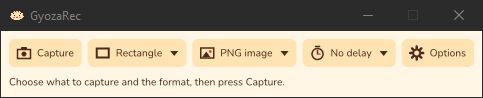
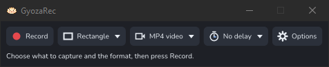
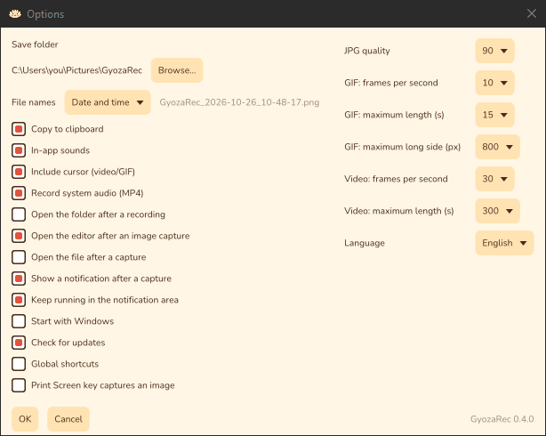
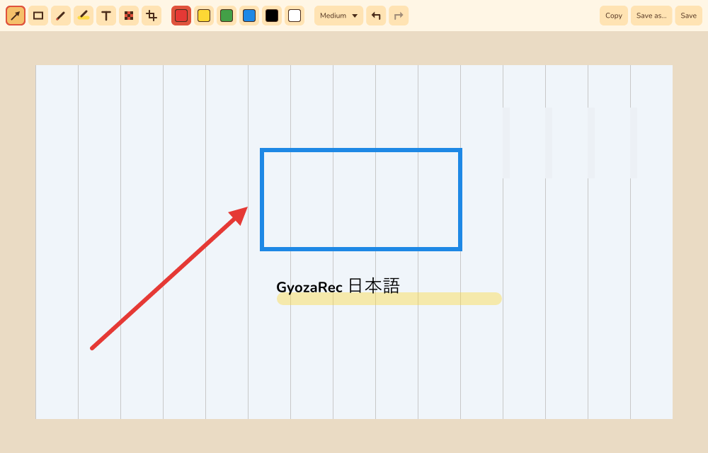
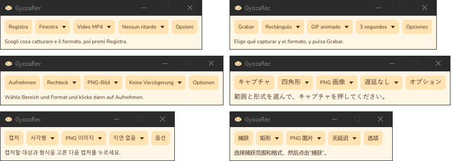

<p align="center">
  
</p>

<h1 align="center">GyozaRec</h1>

<p align="center">Fast, cute screen capture: PNG, GIF and MP4, entirely local.</p>

<p align="center">
  <a href="https://github.com/martindavinci/GyozaRec/actions/workflows/ci.yml"></a>
  <a href="https://github.com/martindavinci/GyozaRec/releases/latest"></a>
  <a href="https://github.com/martindavinci/GyozaRec/releases"></a>
  <a href="LICENSE"></a>
  
</p>

## Features

A small toolbar, each button with an icon that shows what it is set to:

- **Capture** (**Record** for videos and GIFs) — starts a capture with the selected area, format and delay. A camera for images, a red dot for recordings.
- **Area** — Rectangle, Lasso, Window, Full screen or All monitors. Lasso (images only) takes the shape you draw while holding the mouse button: outside it a PNG is transparent and a JPG white; programs that read PNG from the clipboard keep the transparency, the others get it on white. Recordings use Rectangle instead. With several monitors, Full screen asks which one: click it, or press Esc to cancel; All monitors takes every monitor at once, as one picture or video. **Capture** and **Record**, the Capture image and Record shortcuts and Print Screen show a bar at the top of the screen to switch between these areas, or to cancel; the area picked there becomes the toolbar's. When the bar is in the way, drag it by its dots (or any part that is not a button) anywhere on that monitor; it goes back to the top next time. Full screen on a single monitor and All monitors capture at once.
- **Format** — PNG image, JPG image, MP4 video or Animated GIF. Any area works with any format. The same menu has **Convert a video to GIF…**.
- **Delay** — from no delay up to 5 seconds.
- **Options** — save folder, file names (date and time such as `2026-10-26_14-30-05.png`, optionally starting with `GyozaRec_`, or ten random characters such as `k3F9xQ2bTm.png`; a name already taken gets `_2`, `_3`… at the end), copy to clipboard, in-app sounds, cursor in recordings, system audio in MP4s, opening the folder after a recording, what an image capture does (save and open the editor, only save, or only copy and open the editor), asking to save when closing the editor, opening the file after a capture, the notification after a capture, notification area, start with Windows, update check, global shortcuts, JPG quality, frame rate and maximum length of GIFs and videos, language, theme (Automatic follows Windows' app mode: Gyoza when it is light, Slate when it is dark; or always Gyoza (light), Slate (dark, blue-grey) or Toasted (dark, warm brown)); a theme picked there shows at once; interface size, from 100 % to 200 % on top of Windows' display scale (also Ctrl + mouse wheel or Ctrl +/- on the toolbar). **Apply**, next to OK and Cancel, saves the changes and keeps the window open; it stays off until something changes.

<p align="center">
  
  &nbsp;&nbsp;
  
</p>

<p align="center">
  
</p>

Images are copied to the clipboard; videos and GIFs are copied as files. A window recording keeps the area the window covered when recording started. While recording, a small panel shows the elapsed time with **Pause**/**Resume**, **Stop** and **Discard** buttons; paused time is left out of the file, and discarding asks for confirmation first. Nothing leaves your computer: no uploads, no accounts. The only network request is a once-a-day question to GitHub about the latest release (**Check for updates** in **Options**); when there is a newer one, the status line offers to download it.

MP4 recordings include the **system audio** (what the computer plays) by default; turn it off in **Options**. With **In-app sounds** on, short tones mark the start, pause, resume and end of a recording, and they are timed so they never end up in the video.

GIFs store only what changes from one frame to the next, so recordings of mostly still screens stay small. **Convert a video to GIF…** (in the **Format** menu and the notification area menu) turns an MP4 into a GIF next to it, with the GIF options for frame rate, size and maximum length; the status line shows the progress and can cancel it.

After each saved capture a small notification shows its thumbnail in the corner of the screen: click it to open the file (images open in the editor). Turn it off in **Options**.

### Editor

Every image capture opens in the editor (turn this off with **Image captures** in **Options**; the editor then replaces "Open the file after a capture" for images). The file is already saved and copied, so closing the editor without changes loses nothing.

With **Image captures** set to **Copy and open the editor, don't save**, nothing is written to disk: the capture is copied to the clipboard (whatever **Copy to clipboard** says) and opens in the editor under the name it would have had, marked "Not saved yet" in the title. **Save** writes it to the save folder; the status line, the notification and "Open the file after a capture" stay out of the way.

<p align="center">
  
</p>

- Tools: **arrow**, **rectangle**, **pen**, **highlighter**, **text** (click, type, Enter), **pixelate** (coarser with a bigger size), **redact** (a solid box in the chosen color) and **crop**; six colors and three sizes.
- **QR codes and barcodes** in the picture are read as it opens (QR, Micro QR, Data Matrix, Aztec, PDF417, EAN, UPC, Code 39/93/128, ITF, Codabar…): each gets a line under the tool bar with its text, **Copy** and, for web addresses (http and https only), **Open link**. Nothing is opened until you click, and the reading happens on your computer.
- **Undo** and **Redo** (Ctrl+Z, Ctrl+Y). With **Copy to clipboard** on, every change also goes to the clipboard, so the edited image is always ready to paste.
- **New** (Ctrl+N) captures another image with the current area; the editor gives way to it when it has nothing unsaved. **Open…** (Ctrl+O) edits a PNG or JPG from disk in another window.
- **Save** (Ctrl+S) overwrites the capture and copies it again when **Copy to clipboard** is on; **Save as…** (Ctrl+Shift+S) writes a PNG or JPG elsewhere; **Copy** (Ctrl+C) copies the edited image.
- Closing with unsaved changes, or on a capture never saved, asks whether to save it. Turn off **Editor: ask to save unsaved or edited images** in **Options** to close without asking.

### Notification area and shortcuts

GyozaRec stays in the notification area: closing the toolbar hides it, a click on the icon brings it back, and the icon's menu offers every kind of capture, **Options** and **Exit**. Turn this off in **Options** to make closing the toolbar quit the app.

Global shortcuts are off by default; turn them on in **Options**, where each one can also be switched off on its own or given new keys (click its keys and press the new combination; **Reset shortcuts** restores these defaults):

| Shortcut | Action |
|---|---|
| Ctrl+Shift+F7 | Capture an image (current area) |
| Ctrl+Shift+F8 | Capture the full screen |
| Ctrl+Shift+F9 | Record (current area; MP4 unless GIF is selected) |
| Ctrl+Shift+F10 | Record the full screen |
| Print Screen | Capture an image (optional; Windows' own Print Screen shortcut must be turned off) |

If another app already uses a combination, **Options** marks it as unavailable and the previous keys stay in use.

**Start with Windows** (off by default) launches GyozaRec hidden in the notification area when you sign in; it also works for the portable version, which updates its entry when the folder moves. Turn the option off before uninstalling or deleting the portable folder: otherwise the sign-in entry stays behind, pointing to a missing file (Windows ignores it).

### Command line

| Option | Starts |
|---|---|
| `--capture` | a capture with the toolbar's current settings |
| `--capture-image` | an image of the current area |
| `--capture-fullscreen` | an image of the full screen |
| `--record` | a recording of the current area |
| `--record-fullscreen` | a recording of the full screen |

If GyozaRec is already running, the capture starts in that instance. A shortcut to `gyozarec.exe --record` starts recording with one click.

The interface is available in English, Spanish, French, German, Italian, Brazilian Portuguese, Japanese, Korean and Simplified Chinese. The language follows Windows on first start and can be changed in **Options**. Corrections from native speakers are welcome.

<p align="center">
  
</p>

## Download

From the [Releases page](https://github.com/martindavinci/GyozaRec/releases/latest):

| Package | What it does |
|---|---|
| `GyozaRec_<version>_x64.msi` | Installs for the current user in `%LOCALAPPDATA%\Programs\GyozaRec`, without administrator rights, with a Start menu shortcut. Settings live in `%APPDATA%\GyozaRec`, captures in `Pictures\GyozaRec`. Uninstall from "Installed apps". |
| `GyozaRec-<version>-windows-x64-portable.zip` | Portable version: extract it and run `gyozarec.exe`. Settings and captures stay in the folder (`data\` and `Captures\`). |

Requires Windows 10 (version 2004 or later) or Windows 11, 64-bit. macOS and Linux are planned.

If GyozaRec ever stops because of an error, the details are saved to `crash.log` next to the settings; attaching it to a bug report helps.

**Accessibility:** the interface is drawn by GyozaRec itself, so screen readers cannot read it yet and the windows do not support moving between controls with Tab.

## Building

You need Rust 1.99 or later with the MSVC toolchain; `rust-toolchain.toml` selects the exact version used for releases.

```
cargo build --release
cargo test
```

To build the MSI installer and the portable zip (requires `cargo install cargo-packager --locked`; cargo-packager downloads WiX, which needs .NET Framework 3.5):

```
cargo xtask dist
```

## License

MIT, see [`LICENSE`](LICENSE). The Nunito font is distributed under the SIL Open Font License, see [`assets/fonts/OFL.txt`](assets/fonts/OFL.txt).
